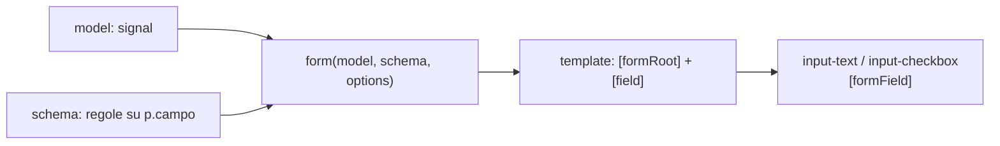
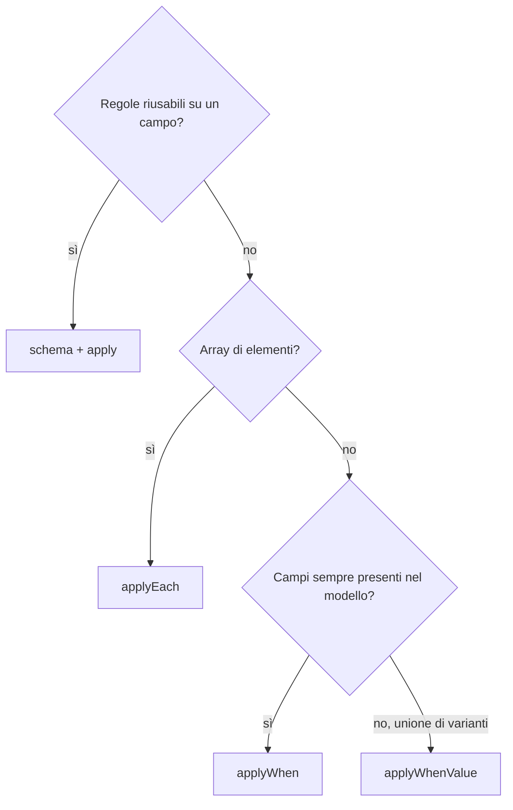

# Guida ai Signal Forms

Panoramica con esempi. Le regole di dettaglio (validazione, submit, stato, validatori, componenti, traduzioni) sono in `.claude/rules/signal-forms.md` e `.claude/rules/form-components.md`: qui non si ripetono.

## Come è fatto un form



Modello, regole e template sono separati. Esempio minimo (`pages/login/login.ts`):

```ts
model = signal<LoginModel>({ email: '', password: '' });

form = form(
  this.model,
  (p) => {
    apply(p.email, emailFieldSchema);
    required(p.password);
    minLength(p.password, 8);
  },
  { submission: { action: (field) => /* Promise */ } },
);
```

```html
<form [formRoot]="form">
  <app-input-text label="login.fields.email" type="email" [field]="form.email" />
  <button type="submit" [disabled]="form().invalid() || form().submitting()">Accedi</button>
</form>
```

## Submit su API

```ts
submission: {
  action: (field) =>
    new Promise<TreeValidationResult>((resolve) => {
      const credentials = field().value();
      this._authService
        .login(credentials.email, credentials.password)
        .pipe(takeUntilDestroyed(this._destroyRef))
        .subscribe({
          next: () => { this._onLoginSuccess(); resolve(undefined); },
          error: (error: unknown) => { this._onLoginError(error); resolve(undefined); },
          complete: () => resolve(undefined),
        });
    }),
},
```

`resolve(undefined)` = nessun errore di validazione. Gli errori dell'API vanno in un toast.

## Quale schema usare



Esempi in `pages/register/register.ts`: `emailFieldSchema` (apply), `items` (applyEach), `promoCode` (applyWhen), `customer` Privato/Azienda (applyWhenValue).

## Validatore custom

```ts
// shared/validators/url.validator.ts
export function https(path: SchemaPath<string>): void {
  validate(path, ({ value }) =>
    !value() || value().startsWith('https://') ? null : { kind: 'https' },
  );
}
```

Uso nello schema: `https(p.website)`. Serve la voce `common.validation.https` in `public/i18n/it.json` e un `url.validator.spec.ts`.

## Checklist per un nuovo form

1. Interfaccia del modello e `signal` con valori iniziali definiti.
2. Regole nello schema di `form()`.
3. Template con `[formRoot]`, `[field]` sui controlli e bottone disabilitato su `invalid() || submitting()`.
4. Label ed errori in `it.json`.
5. Validatori custom in `shared/validators` con il loro `.spec.ts`.
