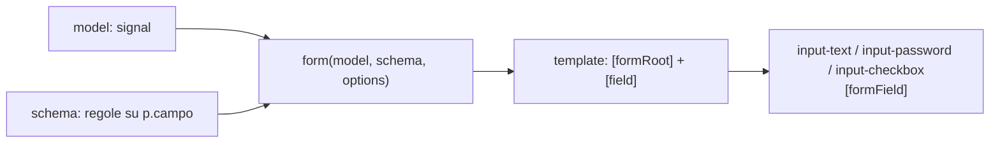
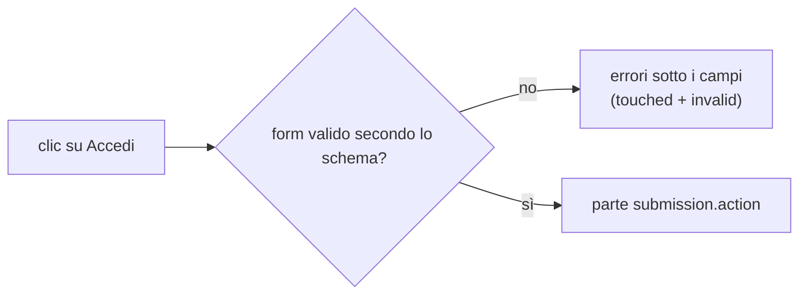
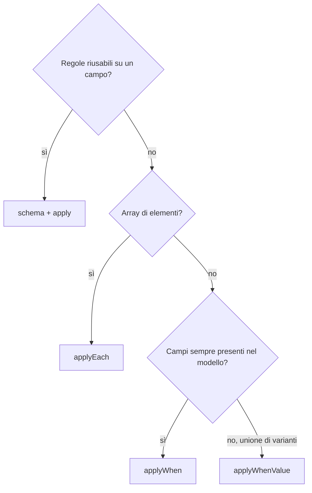
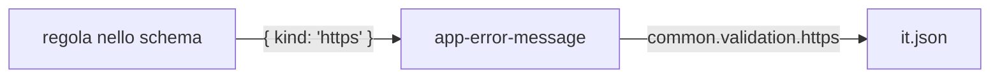

# Il progetto signals-form e i Signal Forms

> Le regole valide per il codice sono in `.claude/rules/` (`signal-forms.md`, `shared-inputs.md`): questo documento le spiega. Se divergono, valgono le rules.

Guida al progetto `signals-form`: un'applicazione Angular 22 con Tailwind CSS 4 che usa solo i **Signal Forms** (`@angular/forms/signals`) per gestire i form.

## 1. Il progetto

### Cosa contiene

| Pagina | Cosa mostra |
| --- | --- |
| `login` | form semplice (email e password) con invio verso un servizio di autenticazione |
| `register` | form completo che usa quasi tutte le regole dei Signal Forms |
| `home` | pagina protetta da `auth.guard` |

Demo del login: `demo@example.com` / `password1`.

Comandi, struttura delle cartelle e convenzioni sono nel [README](../README.md).

## 2. Che cosa sono i Signal Forms

Sono il nuovo sistema di form di Angular basato sui **signal**. Al posto di `FormGroup`, `FormControl` e `ngModel` si descrive il form partendo dai dati:

1. un **modello**: un `signal` con i soli dati;
2. le **regole**: una funzione che dichiara validazione, campi disabilitati, nascosti…;
3. il **template**: collega i campi del form agli input.

Nel progetto non si usano mai `FormGroup`, `FormControl` o `ngModel`.



## 3. Un form passo per passo (login)

### 3.1 Il modello

```ts
interface LoginModel {
  email: string;
  password: string;
}

model = signal<LoginModel>({ email: '', password: '' });
```

Ogni campo parte con un valore **definito** (`''`, `null`, `false`, `[]`). Con `undefined` il campo «non esiste»: non viene creato il suo `FieldTree` e non si può legare a un input.

### 3.2 Le regole

```ts
form = form(this.model, (p) => {
  apply(p.email, emailFieldSchema);
  required(p.password);
  minLength(p.password, 8);
});
```

La funzione schema gira **una sola volta** e riceve i **percorsi** dei campi (`p.email`), non i campi veri.

Per riusare un gruppo di regole si crea uno schema:

```ts
const emailFieldSchema = schema<string>((path) => {
  required(path);
  email(path);
});
```

### 3.3 Il template

```html
<form [formRoot]="form">
  <app-input-text label="login.fields.email" type="email" [field]="form.email" />
  <app-input-password label="login.fields.password" [field]="form.password" />
  <button type="submit" [disabled]="form().invalid() || form().submitting()">Accedi</button>
</form>
```

- `[formRoot]` sul `<form>` gestisce l'invio e aggiunge da solo `novalidate` (spiegato qui sotto).
- `form.email` è il **campo**; il controllo lo riceve come `[field]` e lo lega con `[formField]`.
- Si leggono i dati con `form().value()` e lo stato di un campo con `form.email()` (per esempio `form.email().touched()`).

#### Cos'è `novalidate`

`novalidate` è un attributo HTML del `<form>` che **spegne la validazione nativa del browser**.

Senza, il browser controlla da solo gli input prima dell'invio. Per esempio un `<input type="email">` con testo non valido blocca l'invio e mostra un fumetto con un messaggio in inglese o nella lingua del browser. Sono controlli che il progetto non vuole, per tre motivi:

1. **Due validazioni in conflitto:** le regole vere sono quelle dello schema (`required`, `email`, `minLength`…). Quelle del browser sono diverse e non si possono configurare.
2. **Testi non controllabili:** i messaggi del progetto vengono da `it.json` e compaiono sotto il campo. Il fumetto del browser non è tradotto da noi né ha lo stile dell'app.
3. **Invio bloccato troppo presto:** se il browser blocca il submit, `submission.action` non parte nemmeno e Angular non marca i campi come toccati. Gli errori dello schema non verrebbero mostrati.

Con `novalidate` decide solo Angular:



Non lo si scrive a mano: `[formRoot]` lo aggiunge da solo. Per lo stesso motivo non si usano `:valid`, `:invalid`, `validity` né `validationMessage` del browser: lo stile segue i signal di stato (`touched()`, `invalid()`).

### 3.4 L'invio (submit)

```ts
form = form(this.model, schemaFn, {
  submission: {
    action: (field) =>
      new Promise<TreeValidationResult>((resolve) => {
        const credentials = field().value();
        this._authService
          .login(credentials.email, credentials.password)
          .pipe(takeUntilDestroyed(this._destroyRef))
          .subscribe({
            next: () => { this._onLoginSuccess(); resolve(undefined); },
            error: (error: unknown) => { this._onLoginError(error); resolve(undefined); },
            complete: () => resolve(undefined),
          });
      }),
  },
});
```

- `[formRoot]` esegue l'azione **solo se il form è valido**. Non servono `(submit)` né `submit()` a mano.
- L'azione restituisce una `Promise<TreeValidationResult>`. Finché è pendente, `form().submitting()` è `true`: si usa per disabilitare il bottone e cambiare il testo.
- `resolve(undefined)` significa «nessun errore di validazione».
- Gli errori dell'API non diventano errori di campo: si mostrano in un toast.
- Con `complete` la Promise si risolve anche se il componente viene distrutto a metà chiamata.

## 4. Le regole di validazione

Si dichiarano **solo nello schema**, mai nel template né nei componenti dei controlli. Le regole sono indipendenti: la validazione non si ferma al primo errore. Non si passa `message`: il testo arriva da `it.json` in base al `kind` dell'errore.

| Regola | Uso |
| --- | --- |
| `required`, `email`, `pattern` | testo (`required` considera vuoti `null`, `undefined`, `''`, `false`, `NaN`) |
| `minLength`, `maxLength` | stringhe (caratteri) e array (elementi) |
| `min`, `max` | numeri |
| `minDate`, `maxDate` | date da `<input type="date">`, con limiti sempre in UTC |
| `validate` | regola custom su un campo: restituisce `{ kind }` oppure `null` |
| `validateTree` | regola su un gruppo di campi |
| `validateHttp` | regola asincrona; mentre attende `pending()` è `true` |

Regole utili:

```ts
// tra più campi: valueOf() legge un altro campo e la regola si riesegue se cambia
passwordMatch(p.confirmPassword, p.password);

// condizionale
required(p.promoCode, { when: ({ valueOf }) => valueOf(p.applyDiscount) });
```

## 5. Gli schemi

| Strumento | Quando usarlo | Dove vederlo nel progetto |
| --- | --- | --- |
| `schema` + `apply` | regole riusabili su un campo | `emailFieldSchema` |
| `applyEach` | stesse regole su ogni elemento di un array | `items` in `register.ts` |
| `applyWhen` | i campi esistono sempre, la regola si accende con una condizione | `promoCode` con lo sconto |
| `applyWhenValue` | il modello è un'**unione di varianti** | `customer` Privato / Azienda |



**Array:** nel template `@for (item of form.items; track $index)` con `[field]="item.name"`. Si aggiunge e si toglie con `model.update(...)`.

**Unioni:** un'unione espone solo le chiavi comuni. Per il template si fa un cast al tipo della variante (`form.customer as unknown as FieldTree<CompanyCustomer>`) e si mostra il campo con `@if`. Per cambiare variante si sostituisce l'intero oggetto nel modello.

## 6. Lo stato dei campi

Si legge come signal da `form.campo()`:

| Signal | Significato |
| --- | --- |
| `valid()` / `invalid()` | esito (`valid()` è `false` mentre una regola async è in corso) |
| `errors()` | array di errori `{ kind, ... }` |
| `pending()` | regola asincrona in corso |
| `touched()` / `dirty()` | campo toccato / valore modificato |
| `disabled()` / `hidden()` | disabilitato / nascosto |
| `submitting()` | solo sul form: invio in corso |

Gli errori si mostrano **solo con `touched() && invalid()`**, così non compaiono prima che l'utente interagisca. Non si usano `:valid`/`:invalid` o `validationMessage` del browser.

### Disabilitato, nascosto, sola lettura

Si dichiarano nello schema, non con l'attributo `disabled` del template:

```ts
disabled(p.username);                                    // sempre disabilitato
disabled(p.promoCode, { when: ({ valueOf }) => !valueOf(p.applyDiscount) });
hidden(p.promoCode, { when: ({ valueOf }) => !valueOf(p.applyDiscount) });
```

Un campo disabilitato non contribuisce alla validazione né a `touched`/`dirty`, quindi non rende il form invalido. Il suo valore resta però in `form().value()`.

## 7. I validatori personalizzati

Stanno in `src/app/shared/validators/<tema>.validator.ts`, mai nei componenti. Hanno due livelli nello stesso file:

1. una **funzione pura** sul valore (testabile senza Angular);
2. una **regola Signal Forms** che la usa, con `validate()`.

```ts
export function https(path: SchemaPath<string>): void {
  validate(path, ({ value }) =>
    !value() || value().startsWith('https://') ? null : { kind: 'https' },
  );
}
```

- La regola restituisce `{ kind }` oppure `null`; per più requisiti mancanti, un array di errori.
- Un campo vuoto non è un errore del validatore: ci pensa `required()`.
- Ogni validatore ha il suo `.spec.ts`. Le regole si provano creando un `form()` in contesto di iniezione e leggendo `errors()`.

## 8. I componenti dei controlli

| Componente | Ruolo |
| --- | --- |
| `app-input-text` | `text`, `email`, `tel`, `url`, `number`, `date` |
| `app-input-password` | password con pulsante mostra/nascondi |
| `app-input-checkbox` | casella booleana |
| `app-field-wrapper` | label tradotta + controllo + errori |
| `app-error-message` | primo errore, tradotto in base al `kind` |
| `app-toast` | contenitore dei toast, una sola volta in `app.ts` |

- Il controllo riceve il `FieldTree` come `[field]` e lega `[formField]`. **Non contiene regole di validazione**: mostra solo `invalid()` ed `errors()`.
- Ogni controllo avvolge il suo `<input>` in `<app-field-wrapper>`.
- `app-input-password` tiene lo stato mostra/nascondi in un signal di interfaccia (`visible`), fuori dal modello del form.

## 9. Le traduzioni

I testi stanno in `public/i18n/it.json` e si leggono con `translate(chiave, params)`.

- **Label:** `label="login.fields.email"` è una chiave; il wrapper la traduce. Se la chiave manca, a schermo si vede la chiave.
- **Errori di validazione:** `common.validation.<kind>`, con `{{field}}` uguale alla label tradotta con la prima lettera minuscola.
  Esempio: `"required": "Il campo {{field}} è richiesto"`.
- **Nuovo `kind` custom:** si aggiunge subito la sua voce in `common.validation`.
- **API e toast:** sezione dedicata, per esempio `login.errors.invalidCredentials`.

### Il punto in cui le due parti si incontrano



Un validatore custom richiede quindi due interventi: la regola nel codice e la voce di testo in `it.json`.

## 10. Checklist per un nuovo form

1. Interfaccia del modello e `signal` con valori iniziali definiti.
2. Regole nello schema di `form()`.
3. Template con `[formRoot]`, `[field]` sui controlli e bottone disabilitato su `invalid() || submitting()`.
4. Label ed errori in `it.json`.
5. Validatori custom in `shared/validators` con il loro `.spec.ts`.
6. Per le password usare `app-input-password`, non `app-input-text`.
